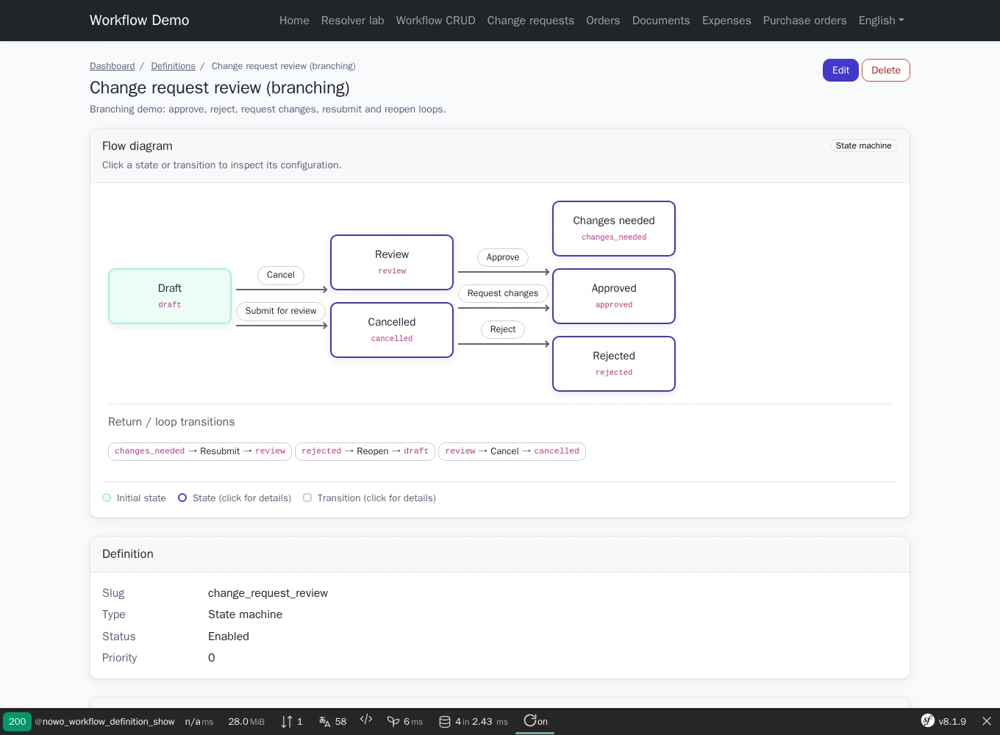
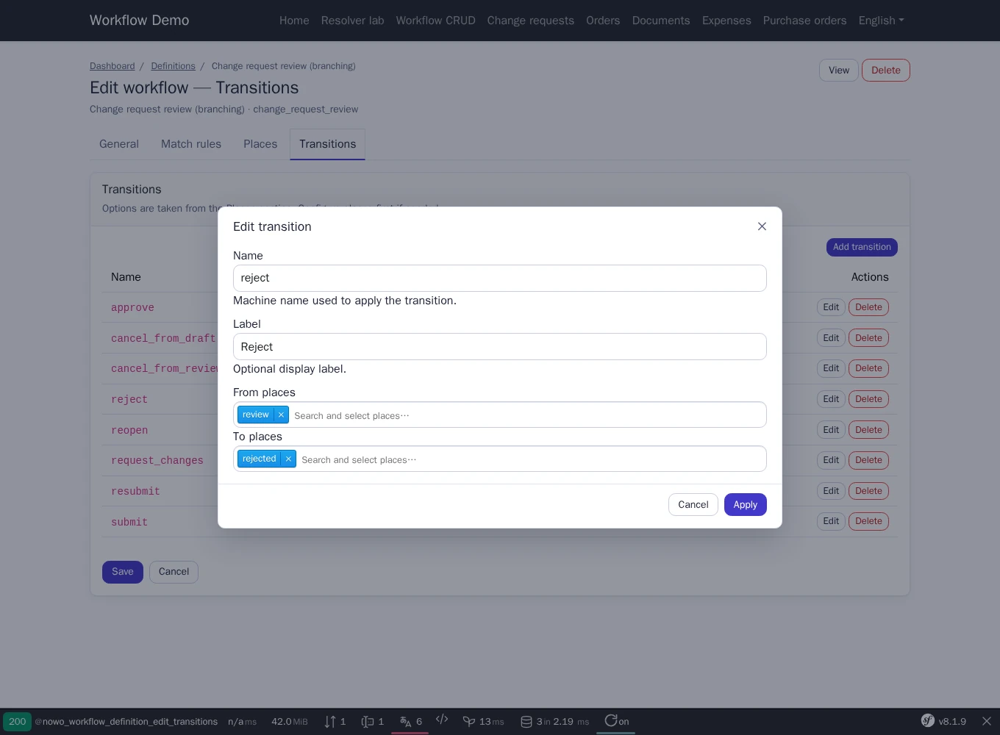
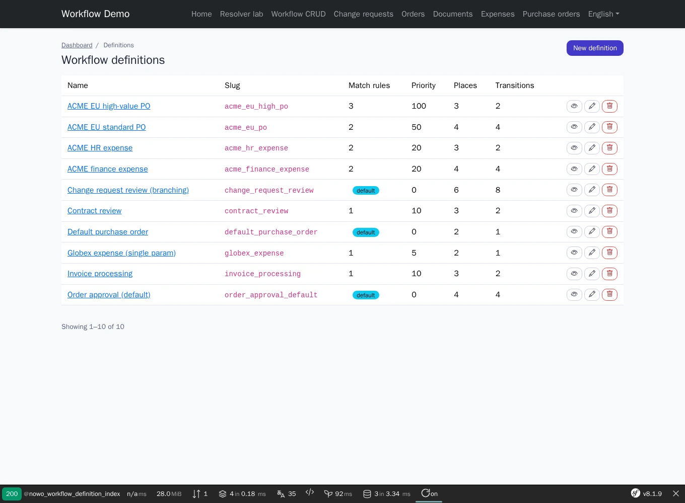

# NowoWorkflowBundle

[](https://github.com/nowo-tech/WorkflowBundle/actions/workflows/ci.yml) [](https://packagist.org/packages/nowo-tech/workflow-bundle) [](https://packagist.org/packages/nowo-tech/workflow-bundle) [](LICENSE) [](https://php.net) [](https://symfony.com) [](https://github.com/nowo-tech/WorkflowBundle) [](#tests-and-coverage)

> ⭐ **Found this useful?** Give it a star on GitHub! It helps us maintain and improve the project.

Define Symfony Workflow state machines and workflows in the database, manage them with a built-in CRUD UI, and execute transitions at runtime through `DatabaseWorkflowRegistry` and `WorkflowApplicator`.

> 📋 **Compatible with Symfony 7.4+ (PHP 8.2+) and 8.x (PHP 8.4+)** — tested on Symfony **7.4**, **8.0**, and **8.1+**.


This bundle is **FrankenPHP worker mode friendly**.

<table>
  <tr>
    <td align="center" width="33%">
      
      <br /><sub>Definition detail — flow diagram of a branching state machine</sub>
    </td>
    <td align="center" width="33%">
      
      <br /><sub>Transitions editor — dialog with searchable from / to places</sub>
    </td>
    <td align="center" width="33%">
      
      <br /><sub>Definitions list — match rules, priority and row actions</sub>
    </td>
  </tr>
</table>

## Features

- Persist workflow definitions (places, transitions, subject class, marking property) in Doctrine
- Configurable Doctrine `table_prefix` for table and constraint names
- Built-in admin UI at `/workflow` (configurable path), protected by default via `security.access_roles` / `WorkflowUiAccessCheckerInterface`
- Admin pages on the UiKit 2.0 page contract (REQ-UI-003): list, show, form, settings and dashboard scaffolds themed once by the host (`nowo_ui_kit.layouts` / `nowo_ui_kit.theme`), flow diagram and collection editors on native `<dialog>`s, no CDN assets — see [Templates](docs/TEMPLATES.md)
- Configurable `web_ui.path_prefix`, `web_ui.layout_template`, `web_ui.templates.<page>` and `web_ui.list_page_size`
- UI translations for `en`, `es`, `fr`, `it`, `de`, `nl`, `pt` (enable extra locales in `web_ui.locales`)
- Runtime resolution via `DatabaseWorkflowRegistry` (Symfony Workflow component)
- `WorkflowApplicator` helper to apply transitions and flush subjects
- Demo with order approval (state machine) and document review (parallel workflow)
- FrankenPHP worker mode: Supported (including kernel not reset between requests; see [Demo with FrankenPHP](docs/DEMO-FRANKENPHP.md) and [Worker audit](docs/FRANKENPHP-WORKER-AUDIT.md))

## Quick start

```bash
composer require nowo-tech/workflow-bundle
```

```yaml
# config/packages/nowo_workflow.yaml
nowo_workflow:
    web_ui:
        path_prefix: '/workflow'
        # layout_template: null → nowo_ui_kit.layouts.admin (your layout / bridge, set once in UiKit)
    security:
        access_roles: [ROLE_ADMIN]
```

```bash
php bin/console nowo:workflow:sync-schema
php bin/console nowo:workflow:seed-demo   # optional sample definitions
```

## Demo

```bash
make -C demo up-symfony8
```

Open http://localhost:8022 — try the CRUD at `/workflow` and playgrounds for orders/documents.

Playwright e2e and the README screenshots (REQ-DEMO-013): `make -C demo/symfony8 test-e2e` and
`make -C demo/symfony8 demo-screenshots` (after `make -C demo/symfony8 reset-demo`).

Smoke check (boot + HTTP 200):

```bash
make demo-smoke
```

## Documentation

- [Installation](docs/INSTALLATION.md)
- [Configuration](docs/CONFIGURATION.md)
- [Templates (UiKit page contract)](docs/TEMPLATES.md)
- [PSR evaluation (REQ-CS-007)](docs/PSR.md)
- [Usage](docs/USAGE.md)
- [Contributing](docs/CONTRIBUTING.md)
- [Code of Conduct](CODE_OF_CONDUCT.md)
- [Changelog](docs/CHANGELOG.md)
- [Upgrading](docs/UPGRADING.md)
- [Release](docs/RELEASE.md)
- [Security](docs/SECURITY.md)
- [Engram](docs/ENGRAM.md)
- [Spec-driven development](docs/SPEC-DRIVEN-DEVELOPMENT.md)
- [GitHub Spec Kit](docs/SPEC-KIT.md)

### Additional documentation

- [Demo with FrankenPHP](docs/DEMO-FRANKENPHP.md)
- [FrankenPHP worker audit (no kernel reset)](docs/FRANKENPHP-WORKER-AUDIT.md)
- [GitHub Actions CI requirements](docs/GITHUB_CI.md)

## Tests and coverage

| Area | Coverage |
|------|----------|
| PHP | 100% |

```bash
make test
make test-coverage
```
